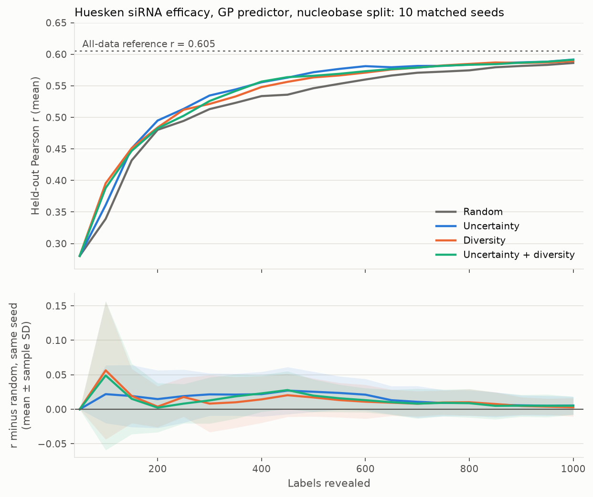
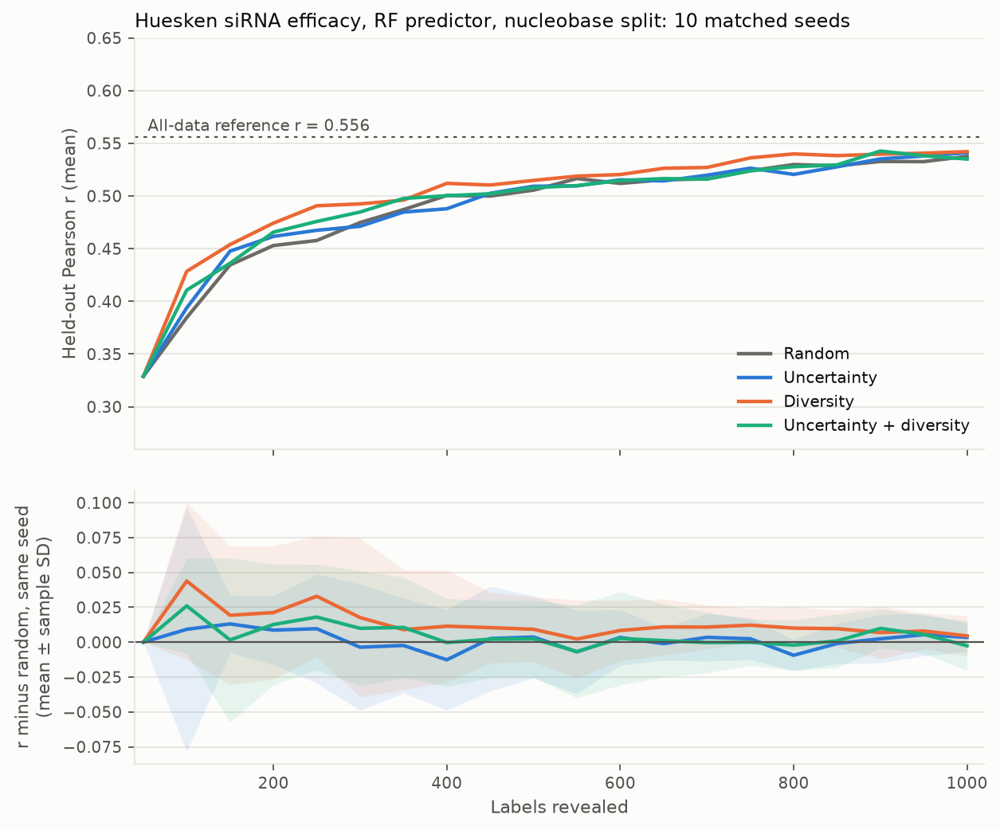

# Four-policy acquisition comparison on Huesken (I4/I5)

**Protocol frozen 2026-11-14 before any run. Results are appended below the line
"Results" only after the runs finish; nothing above that line changes afterwards.**

## Question

At matched label budgets, does choosing which siRNAs to label by (a) predictor
uncertainty, (b) sequence diversity, or (c) both reach better held-out accuracy than
random choice? A flat or negative answer is a valid result and will be reported as is.

## Design

- Data/endpoint: Huesken, `Ichihara_2007_1`, 2,431 siRNAs, percentage inhibition,
  labels unchanged (including 134 values above 100).
- Split: official OligoGym **`nucleobase`** split (8 k-mer clusters, test_size 0.2)
  per seed. Not a target split; no target-split claim is made.
- Seeds 100-109 (ten), each with one split and one initial set shared by all arms.
  Initial 50 labels drawn uniformly (runner default); batches of 50; maximum 1,000
  labels (about 55% of the smallest training pool, 1,713 rows), so 20 checkpoints.
- Arms (primary predictor: one-hot GP, `gp_latent_sd_uncalibrated`):
  1. `random`: uniform without replacement.
  2. `uncertainty`: top-50 predictor uncertainty (existing policy).
  3. `diversity`: greedy farthest point in one-hot space, label-free, no predictor.
  4. `uncertainty_then_diversity`: top 200 (4x batch) by uncertainty, then greedy
     farthest point inside that pool measured against labeled and chosen rows.
  The 4x pool multiplier is fixed now and will not be tuned.
- Secondary predictor (same four arms, same seeds): one-hot RF with
  `rf_tree_prediction_sd_uncalibrated`. Reported separately, not pooled with the GP.
- Kernel and RF settings are those frozen in `predictor-first-pass.md`.
- Runner: unchanged `run_campaign`, `purpose="diagnostic"` (the runner's research
  guard still reads "pending Gate 1 integration" although Gate 1 is closed in
  `gate1-resolution.md`; updating it is an integrator task).

## Metrics (all fixed in advance)

- Pearson r on the held-out `nucleobase` test partition at each checkpoint
  (RMSE, MAE recorded too), plus a separate full-training-pool reference per seed.
- Primary statistic: normalized trapezoidal area under the Pearson curve over
  [50, 1000] labels, paired per seed against `random`. Report every seed, the mean
  difference and sample SD (not a confidence interval) and how many seeds favor each
  arm. n = 10 is small; no significance claim is made.
- Label efficiency: first checkpoint whose r is at least that seed's own full-pool
  reference r minus 0.03; `not_reached` otherwise. Also the runner's absolute 0.60
  threshold. No interpolation.
- Context for every curve: the full-pool reference r (mean +- SD across seeds).

## Expectations stated before running

- The GP latent SD is almost flat but tracks distance to the labeled set (rank
  correlation 0.54), so arms 2 and 3 may behave alike. The hybrid may not separate
  from either. All arms may sit within noise of random; that would be reported.
- The 1,000-label cap may not reach the full-pool reference; if so the figure says so.

## Non-claims

No wet-lab, therapeutic, or target-generalization claim. Retrospective replay on an
existing labeled pool only. Seeds, arms, budgets and the hybrid pool size are not
changed after seeing results; failed runs are recorded, never dropped.

## Results

Run 2026-11-14: 80 runs (4 arms x 2 predictors x 10 seeds), no failures. Every r is
on the official `nucleobase` split. Dispersion is sample SD across seeds, not a
confidence interval. Per-seed paired differences are in the generated `summary.json`
(`scripts/analyze_acquisition.py`); figures are in `docs/figures/`.

### GP predictor (primary), all-data reference r = 0.605 +- 0.039

| Arm | r@100 | r@200 | r@500 | r@1000 | AULC minus random (mean +- SD) | Seeds above random | Median labels to reach reference - 0.03 |
| --- | ---: | ---: | ---: | ---: | ---: | ---: | ---: |
| Random | 0.339 | 0.480 | 0.546 | 0.586 | 0 | n/a | 825 (10/10 seeds) |
| Uncertainty | 0.361 | 0.495 | 0.572 | 0.592 | +0.0157 +- 0.0187 | 9/10 | 550 (10/10) |
| Diversity | 0.396 | 0.484 | 0.563 | 0.589 | +0.0130 +- 0.0210 | 8/10 | 650 (9/10) |
| Uncertainty + diversity | 0.388 | 0.483 | 0.566 | 0.591 | +0.0137 +- 0.0171 | 9/10 | 600 (10/10) |

### RF predictor (secondary), all-data reference r = 0.556 +- 0.050

| Arm | r@100 | r@200 | r@500 | r@1000 | AULC minus random (mean +- SD) | Seeds above random | Median labels to reach reference - 0.03 |
| --- | ---: | ---: | ---: | ---: | ---: | ---: | ---: |
| Random | 0.385 | 0.453 | 0.506 | 0.538 | 0 | n/a | 600 (10/10 seeds) |
| Uncertainty (tree spread) | 0.394 | 0.462 | 0.509 | 0.541 | +0.0015 +- 0.0162 | 4/10 | 700 (9/10) |
| Diversity | 0.428 | 0.474 | 0.515 | 0.542 | +0.0135 +- 0.0208 | 8/10 | 675 (10/10) |
| Uncertainty + diversity | 0.411 | 0.466 | 0.508 | 0.535 | +0.0049 +- 0.0147 | 6/10 | 600 (9/10) |

### Reading

- With the GP, all three non-random arms beat random by a modest, early margin: about
  +0.013 to +0.016 normalized AULC (roughly 1.5 correlation points averaged over the
  curve), positive in 8-9 of 10 seeds, largest at 100 labels (+0.02 to +0.06) and
  essentially gone by 800-1,000 labels (at most +0.006 at 1,000). The paired standard
  error is about 0.006 with n = 10 seeds on one dataset, so this is descriptive, not
  a significance claim. Seed 108 was negative for all three GP arms (-0.017 to
  -0.022) and seed 107 for diversity (-0.019).
- Label efficiency: GP random needs a median 825 labels to get within 0.03 of its own
  all-data reference; uncertainty needs 550 and the hybrid 600, i.e. roughly a third
  of the pool instead of roughly 45%. The reference itself is weak (r about 0.6), so
  this is a label-saving on a modest target, not a discovery result. Absolute 0.60 was
  reached in 6 (random, uncertainty) or 7 (diversity, hybrid) of 10 seeds.
- The hybrid did not beat either parent: the three GP arms differ from each other by
  at most 0.003 AULC against seed SDs near 0.02. The plan's promise that
  uncertainty + diversity is the winning arm is **not supported** here.
- Consistent with, but not proof of, the earlier diagnosis that GP latent SD is
  mostly a novelty signal: RF tree-spread uncertainty, which tracked neither error nor
  novelty, did no better than random (+0.0015, 4/10 seeds) while explicit diversity
  helped the RF about as much as it helped the GP (+0.0135, 8/10). The common factor
  of the arms that help is coverage of sequence space, not model uncertainty. This
  inference was not tested directly.
- Limits: seeds 100-109 only; one dataset; fixed predictors; all curves converge
  toward the reference as labels grow; runs carry `purpose="diagnostic"` because the
  runner's research guard has not been updated for the closed Gate 1.

## Post-hoc significance analysis (exploratory)

`scripts/significance_acquisition.py`. Added after the results above had been seen,
so it is exploratory: "does uncertainty beat random?" was chosen after inspecting
these ten seeds and cannot be confirmed on them. Paired by seed against random; paired
t-test, exact Wilcoxon signed-rank and a percentile-bootstrap CI (10,000 resamples;
at n = 10 it is probably too narrow, a t interval would be wider); Holm correction
within each stated family. These describe these seeds on this dataset, not other
endpoints.

GP predictor, primary statistic (normalized AULC minus random, Holm over 3 arms):

| Arm | Mean diff [bootstrap 95% CI] | dz | t-test p (Holm) | Wilcoxon p (Holm) |
| --- | ---: | ---: | ---: | ---: |
| Uncertainty | +0.0157 [+0.0046, +0.0264] | 0.84 | 0.026 (0.078) | 0.027 (0.059) |
| Diversity | +0.0130 [+0.0004, +0.0250] | 0.62 | 0.083 (0.083) | 0.131 (0.131) |
| Uncertainty + diversity | +0.0137 [+0.0042, +0.0241] | 0.80 | 0.032 (0.078) | 0.020 (0.059) |

- **Not significant after correction.** Uncorrected, uncertainty and the hybrid sit at
  p of roughly 0.02-0.03; after Holm they are 0.06-0.08. The data are suggestive of a
  modest gain, not a demonstrated one.
- Label efficiency (labels saved vs random to reach each seed's own reference - 0.03;
  positive means fewer labels; not reached coded 1,050): uncertainty +200 [+5, +375]
  (t p 0.079, Wilcoxon 0.064, Holm 0.24 / 0.19); diversity +125 (p 0.106); hybrid
  +155 (p 0.117). None significant.
- Fixed budgets (r minus random at 100-1,000 labels, Holm over 12 tests per predictor):
  the smallest uncorrected p is 0.022 (uncertainty at 500 labels), Holm 0.40. No
  budget is significant.
- Arms against each other: uncertainty minus diversity +0.0028 (p 0.49); uncertainty
  minus hybrid +0.0021 (p 0.44). The three GP arms are not distinguishable.
- RF predictor: uncertainty +0.0015 (p 0.77), hybrid +0.0049 (p 0.32), diversity
  +0.0135 (p 0.070, Holm 0.21); label efficiency and fixed budgets also null after
  correction (diversity at 100 labels p 0.036, Holm 0.61).

## Confirmatory run (protocol frozen 2026-11-14 on approval, before any run)

- Fresh seeds 110-149 (40), never inspected (command: `--seeds 110 150 --predictors gp`); GP predictor, same four arms, budgets,
  split and analysis as above. The seeds 100-109 results stay labeled exploratory.
- One primary hypothesis fixed in advance: uncertainty minus random normalized AULC
  is positive, two-sided paired t-test at alpha 0.05 (Wilcoxon as a robustness check).
  Diversity and hybrid minus random, and labels-to-reference - 0.03, are secondary with
  Holm correction. No other tests are primary.
- Power: the exploratory dz of 0.84 is inflated by selection. At a true dz of 0.5, 40
  seeds give about 88% power; at 0.4, about 72%. A null at 40 seeds would be reported
  as such.
- Estimated cost: the 80 runs above took about 15 minutes with 5 workers; 160 GP runs
  should take roughly 25-40 minutes.
