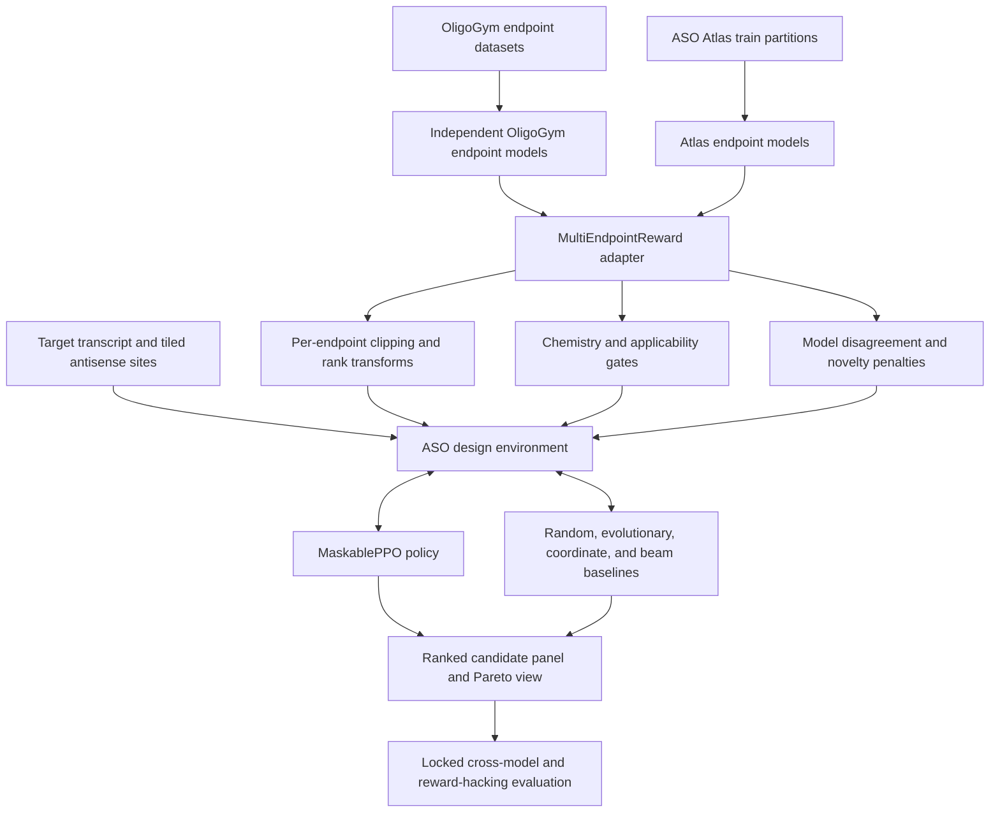

# OligoGym + ASO Atlas Multi-Endpoint Reward and RL Build Plan

**Status:** context anchor for the next implementation steps  
**Prepared:** 2026-11-14  
**Repository:** `/Users/harrisonmartel/hackprinceton/Princeton_hacks`  
**Repository snapshot reviewed:** `main` at `930b6fa`

## 1. Decision

Keep OligoGym. The existing OligoGym-trained endpoint models remain the scientific and software foundation of the system.

ASO Atlas is the next supervised modeling stage: it expands the ASO efficacy and toxicity evidence base and can supply new or improved endpoint predictors. The resulting predictors should be frozen and assembled with the existing OligoGym predictors behind a multi-endpoint reward interface. A separately trained reinforcement-learning policy can then optimize ASO candidates against that frozen reward system.

This is a **multi-model, multi-endpoint reward architecture**. It is not currently a conventional neural network with one shared encoder and several jointly trained heads. “Head” in this plan means one endpoint-specific reward component behind a common scoring interface.

## 2. Terminology

- **OligoGym training:** task-specific supervised fitting or reproduction on an OligoGym endpoint. Most current models are fitted independently and from scratch.
- **Pretrained model:** reserved for a model with prior learned weights, such as RNA-FM. The main GP, RF, and OligoGym CNN studies are not a shared pretrained backbone.
- **Atlas training:** fitting a new endpoint model on ASO Atlas.
- **Atlas continuation or fine-tuning:** continuing a compatible neural checkpoint on Atlas. This term applies only if a real checkpoint is loaded and updated.
- **Multi-endpoint reward:** a common scoring layer that combines several frozen predictors while preserving endpoint identity, chemistry scope, ranges, and uncertainty limitations.
- **RL training:** updating a policy, such as MaskablePPO, by interacting with an ASO design environment scored by the frozen multi-endpoint reward.

## 3. Current repository components

| Component | Current implementation | Status for this plan |
| --- | --- | --- |
| Huesken siRNA efficacy | Independent one-hot GP/RF studies and a source-audited OligoGym CNN | Retain as evidence and a modality-specific benchmark; do not use as ASO potency |
| ASOptimizer ASO efficacy | Chemistry-aware GP/RF; deployment arm is the matched-chemistry GP | Retain as the initial ASO potency reward component and Atlas comparison baseline |
| MOE neurotoxicity | Chemistry-aware GP/RF | Retain as the initial PS/2′-MOE safety component |
| TLR7 inhibition | One-hot RF on 2′-OMe gapmers | Retain only for matching 2′-OMe chemistry |
| TLR8 potentiation | One-hot GP on 2′-OMe gapmers | Retain only for matching 2′-OMe chemistry |
| RNA-FM | Frozen representation and Q/V LoRA experiments | Do not make the default backbone; current results did not beat the one-hot baseline |
| ASO Atlas 2.0 | Imported, preserved, cleaned, and audited tables plus supplied folds | Data-ready, but no Atlas predictor is committed on the reviewed branches |
| Candidate design surface | Transcript retrieval/tiling, chemistry-aware candidate construction, independent endpoint scoring | Reuse for ASO candidate generation and hard validity checks |
| Preliminary RL | Remote branch with masked PPO, search baselines, checkpoints, and scorer accounting | Reuse infrastructure only; current environment is single-reward Huesken siRNA without ASO chemistry or target context |

## 4. Proposed system



## 5. Build sequence

### Phase 0 — Freeze interfaces and ownership

Before merging modeling or RL code:

1. Record the exact OligoGym, repository, and Atlas source revisions.
2. Assign one owner for Atlas modeling, one for reward integration, and one for RL/environment work.
3. Preserve `main` as the integration baseline.
4. Avoid merging the entire divergent Atlas/RL branch wholesale. Import reviewed commits or files by purpose because that branch also removes or replaces current endpoint studies and tests.
5. Define a model artifact manifest containing:
   - endpoint and direction;
   - modality and chemistry scope;
   - feature schema;
   - training-data hashes;
   - split membership hashes;
   - label range and units;
   - evaluation metrics;
   - model/checkpoint identity;
   - software versions.

**Exit criterion:** every model can be loaded through a stable predictor interface without silently changing its chemistry or feature contract.

### Phase 1 — Define the Atlas modeling contract

The Atlas owner must specify, before inspecting final test results:

1. **Endpoint:** in-vitro inhibition, dose-response potency, neurotoxicity, or hepatotoxicity.
2. **Prediction unit:** one assay readout, one aggregated compound result, or one dose-response panel.
3. **Inputs:** HELM only, or HELM plus dose, cell line, species, route, treatment duration, and other assay context.
4. **Chemistry scope:** all resolved Atlas chemistries or a PS/2′-MOE subset matching the design surface.
5. **Split contract:**
   - supplied patent-grouped folds for benchmark comparability;
   - a separate target-held-out evaluation for the product/RL use case;
   - exact HELM, compound, and patent isolation across train/test;
   - no assumption that fold numbers align between endpoints.
6. **Missing-label policy:** endpoint-specific rows remain separate; missing toxicity or efficacy labels are not treated as zero.
7. **Out-of-range labels:** preserve source values during ingestion; any clipping used for training or reward transformation must be explicit and reported.

**Exit criterion:** an immutable Atlas experiment config and split manifest exist before model selection.

### Phase 2 — Train and package Atlas endpoint models

Two implementation routes are valid.

#### Route A: new Atlas endpoint models

Fit new predictors using the repo’s validated HELM/chemistry representation or the upstream Atlas/OligoGym adapter. This is the cleanest extension of the current independent-model architecture.

#### Route B: genuine neural continuation

Load a compatible saved neural checkpoint, verify its feature schema and chemistry scope, and continue training on Atlas training partitions. This is only “post-training” if the previous weights are actually loaded and updated. The current GP/RF wrappers cannot be continued in this sense, and the current Huesken CNN adapter resets its network on each fit.

For either route:

1. Run patent-grouped evaluation.
2. Run target-held-out evaluation.
3. Report chemistry-matched performance separately from heterogeneous-chemistry performance.
4. Evaluate retained performance on untouched compatible OligoGym tests.
5. Save a loadable model artifact and manifest.
6. Do not select models based on RL reward or candidate appearance.

**Exit criterion:** at least one Atlas ASO potency model has reproducible held-out results and a documented chemistry/domain contract. Toxicity models may follow independently.

### Phase 3 — Implement the multi-endpoint reward adapter

Add a new adapter above the existing independent predictors. Do not rewrite every predictor into one network.

Proposed interface:

```python
score = reward_model.score(candidate, target_context)

score.predictions       # raw endpoint predictions with units
score.applicability     # chemistry and domain checks
score.normalized        # clipped rank/quantile values
score.constraints       # pass/fail safety and validity checks
score.disagreement      # independent-model disagreement
score.reward            # scalar used by PPO, if all hard gates pass
score.provenance        # model and data identities
```

Required behavior:

1. Preserve raw endpoint predictions in their original units.
2. Refuse cross-chemistry scoring instead of silently extrapolating.
3. Normalize each endpoint using training-only empirical ranks or quantiles.
4. Clip predictions to the training label range before reward calculation.
5. Treat safety as constraints where possible, rather than an arbitrary subtraction from potency.
6. Penalize OligoGym-versus-Atlas disagreement and GP-versus-RF disagreement.
7. Penalize or reject candidates beyond a predeclared novelty threshold.
8. Define behavior for unavailable heads; missing safety scores must not become zero-risk scores.
9. Include off-target, target accessibility, complementarity, length, annotation, and chemistry validity as hard or separately reported constraints.

Initial PS/2′-MOE reward configuration:

- **Primary objective:** Atlas ASO potency rank, if it passes target-transfer evaluation.
- **Potency cross-check:** current ASOptimizer GP/RF.
- **Safety constraint:** current MOE neurotox predictor plus any validated Atlas neurotox predictor.
- **Hepatic constraint:** Atlas hepatotoxicity model when available.
- **TLR heads:** excluded unless the candidate chemistry matches the 2′-OMe training domain.
- **Trust-region terms:** novelty, independent-model disagreement, and measured-range clipping.

**Exit criterion:** fixed candidates produce deterministic, inspectable reward vectors and fail loudly when chemistry or required safety coverage is invalid.

### Phase 4 — Port the RL environment to ASO design

Reuse from the preliminary RL branch:

- Gymnasium environment structure;
- stable action vocabulary and action masks;
- MaskablePPO training and checkpoint reload;
- scorer caching and identity checks;
- validation/final start manifests;
- matched-budget random and evolutionary comparisons;
- artifact and provenance reporting.

Replace the current restricted Huesken formulation:

1. **State:** target-site window, candidate ASO sequence, chemistry pattern, applicable reward-vector summary, novelty, and remaining action budget.
2. **Starting point:** real antisense sites tiled from an explicitly selected transcript.
3. **Actions:**
   - choose or move among valid tiled sites;
   - apply allowed sugar/backbone/base modifications;
   - optionally adjust length within validated bounds;
   - stop.
4. **Action masks:** forbid invalid chemistry, length, annotation, and edit combinations.
5. **Complementarity:** base edits that destroy target complementarity are forbidden unless the environment simultaneously changes the selected target site consistently.
6. **Reward timing:** begin with terminal reward and gamma 1, matching the existing audited harness. Add shaping only as a separately declared ablation.
7. **Frozen scorer:** the policy cannot update reward-model weights.

**Exit criterion:** toy tests reach known optima, ASO episodes preserve all hard constraints, saved PPO checkpoints reload exactly, and rewards match direct scorer calls.

### Phase 5 — Train and evaluate RL against simple search

Run the following methods with the same candidate domain, starting sites, constraints, and scorer-call budgets:

- MaskablePPO;
- random search;
- evolutionary search;
- coordinate search;
- beam search if tractable;
- unchanged starting candidate.

Evaluation partitions:

1. training targets/starts for policy learning;
2. validation targets/starts for checkpoint selection;
3. fresh final targets/starts used once;
4. no reward-model test labels available to the policy or optimizer.

Report:

- best and mean constrained reward;
- potency rank and each safety head separately;
- hard-constraint satisfaction rate;
- novelty and training-set distance;
- OligoGym/Atlas and GP/RF disagreement;
- candidate diversity;
- unique scorer calls and wall-clock cost;
- PPO minus each search baseline with per-seed results;
- reward-hacking checks against G-runs, CpG, 3′-guanine, off-target, accessibility, and complementarity rules.

**Exit criterion:** the RL result is interpreted relative to the baselines. If PPO does not outperform or offer a useful reusable policy advantage, retain the reward system and ship the strongest simpler optimizer.

### Phase 6 — Integration and product surface

1. Integrate only validated Atlas predictors and the reward adapter into `main`.
2. Keep raw endpoint values visible beside any composite ranking.
3. Show chemistry applicability, novelty, and model disagreement to the user.
4. Export the candidate panel with model identities and constraints.
5. Keep RL outputs labeled as predicted design hypotheses rather than measured molecules.

## 6. Go/no-go gates

| Gate | Required evidence | Failure response |
| --- | --- | --- |
| A — Atlas integrity | Reproducible joins, endpoint definitions, and leakage-controlled folds | Fix the data contract before training |
| B — Atlas reward validity | Patent-held-out and target-held-out results; compatible OligoGym retention check | Use Atlas as analysis data, not an RL reward |
| C — Reward integration | Correct chemistry gates, clipping, deterministic scoring, disagreement and novelty behavior | Do not expose a composite reward |
| D — ASO environment | Target complementarity and chemistry validity preserved by every legal action | Do not train ASO PPO |
| E — Optimization | Matched-budget PPO versus random/evolutionary/coordinate/beam baselines | Use the strongest simpler optimizer if PPO adds no value |
| F — Scientific claim | Independent measured validation | Until then, claim optimization of frozen surrogate predictions only |

## 7. Proposed repository additions

Names below are proposed, not existing paths.

```text
configs/
  atlas/
    potency.toml
    neurotox.toml
    hepatotox.toml
  reward/
    ps_moe_v1.toml
  rl/
    aso_masked_ppo_v1.toml

src/oligo_engine/
  atlas/
    loader.py
    splits.py
    models.py
    artifacts.py
  reward/
    multi_endpoint.py
    normalization.py
    constraints.py
  design/
    aso_environment.py

scripts/
  train_atlas_endpoint.py
  evaluate_atlas_endpoint.py
  build_reward_bundle.py
  train_aso_rl.py
  compare_aso_optimizers.py

docs/
  atlas-modeling-protocol.md
  multi-endpoint-reward.md
  aso-rl-protocol.md
```

## 8. Immediate next steps

1. Ask the Atlas owner to state exactly what “post-training” means:
   - new Atlas model;
   - continued neural checkpoint;
   - joint OligoGym/Atlas training;
   - or prediction stacking.
2. Obtain the branch, commit, model class, training config, feature schema, and saved artifact path.
3. Freeze the Atlas potency experiment and split manifest.
4. Run the first Atlas potency fit and target-held-out evaluation.
5. Implement `MultiEndpointReward` against the current OligoGym predictors and a placeholder Atlas predictor interface.
6. Port the preliminary RL environment only after the reward and ASO action contracts pass their gates.

## 9. Non-claims

This system may support claims about:

- reproducible supervised prediction on specified held-out partitions;
- constrained optimization of frozen surrogate predictions;
- comparative optimization performance under matched budgets;
- generation of ranked experimental hypotheses.

It does not, without independent experiments, support claims that:

- a generated ASO binds its intended target;
- a generated ASO is potent, safe, or clinically useful;
- a composite reward is a biological ground-truth utility;
- PPO is superior merely because its reward increases;
- an Atlas result generalizes outside the tested patents, targets, chemistries, and assay contexts.

## 10. Completion definition

The proposed system is complete when:

1. OligoGym endpoint models and validated Atlas endpoint models load behind one frozen reward interface.
2. Every reward component carries its chemistry, units, range, uncertainty type, and evaluation evidence.
3. The ASO environment permits only target-consistent, chemically valid actions.
4. PPO and simple search methods are compared on identical starts and scoring budgets.
5. Final evaluation uses locked targets/starts and includes reward-hacking diagnostics.
6. The product reports a candidate panel with per-endpoint predictions and limitations, not an unsupported “safe and effective” verdict.
