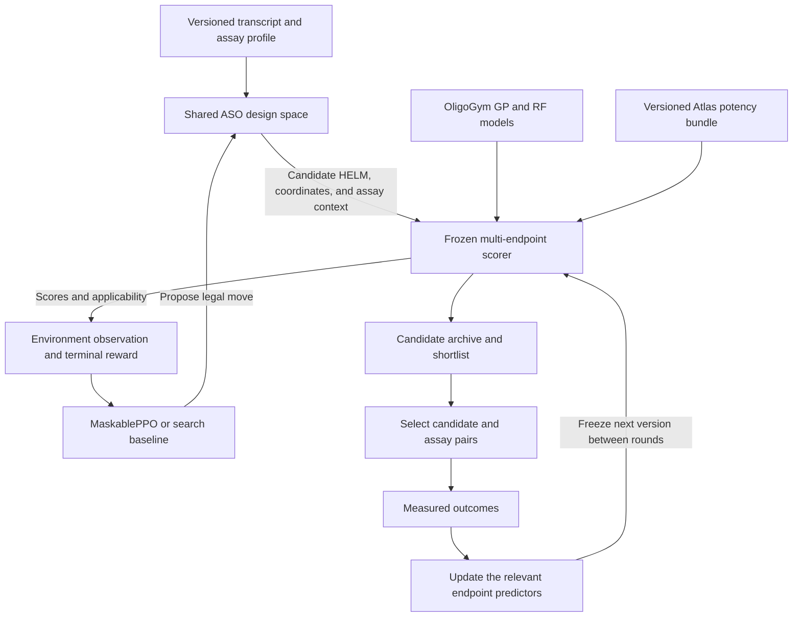

# ASO reinforcement learning environment

> Historical record: the target-window RL scaffold and its experiment runners
> were removed on November 14 at the user's request. Commands for that scaffold
> require the pre-removal checkout (`f26922f`); they are not current entry points.
> Shared prediction/scoring utilities remain. Local retired runs were moved outside
> the checkout; old artifact links below are historical locations.

Implementation handoff for Princeton_hacks · November 14, 2026

## 1. Design to build

Build a target-aware Gymnasium environment that proposes antisense oligonucleotides (ASOs), scores every applicable endpoint on each proposal, and learns which legal design moves find better candidates within a scoring budget. OligoGym supplies the existing endpoint models. The ASO Atlas branch supplies a candidate potency predictor and classical comparison models. Each predictor stays behind a common scoring interface and stays frozen for the duration of an RL run.

The first profile should use the existing 19-mer PS/2′-MOE gapmer template. Optimize one validated potency output subject to explicit, model-based screening and applicability rules. Retain the complete endpoint vector, including advisory results and unavailable endpoints, on each scored candidate. Add a separate 2′-OMe profile for the TLR models once there is compatible potency coverage. Return a candidate panel for experimental follow-up.



**Two update loops.** PPO updates the policy from rollouts against frozen predictions. In a later assay round, measured outcomes update the relevant endpoint predictors. The Atlas dataset supplies supervised labels and retrospective evaluation. An ASO proposed outside the measured pool receives a surrogate score during RL and enters the measured loop once its assay result is available.

## 2. Repository snapshot and implications of the latest pull

`git pull --ff-only` left `main` at `68f6b19` and fetched two previously unseen remote branches. A second pull after the user's clarification reported no newer tips. The Atlas branch's newest commit reviewed here is `1b3fc1e`, committed November 14 at 3:45 p.m. ET.

| Ref reviewed | Evidence | Integration decision |
| --- | --- | --- |
| `main` · `68f6b19` | Transcript tiling, HELM construction, four deployed OligoGym endpoint routes, acquisition experiments, and prepared Atlas tables. | Use as the integration base. |
| `codex/atlas-lora-scaling` · `1b3fc1e` | Single-task, chemistry-aware RNA-FM knockdown predictor with frozen and Q/V LoRA arms, supported by Atlas Ridge and XGBoost comparisons. The intermediate report records 136/240 fit and calibration records and no target-test metrics scored for that run. | Integrate its real input schema and reconstruction path. Treat LoRA as a candidate for the potency role pending paired evaluation. |
| `codex/multi-endpoint-reward-adapter` · `3e8c4b0` | `design/reward.py` has mock predictors, typed metadata and results, applicability, constraints, disagreements, novelty, provenance, and scalar reward composition. The production scoring path still needs real HELM and real model artifacts. | Adapt this scorer and its tests into the production scoring boundary. |
| `codex/preliminary-rl` · `3bbfad6` | Gymnasium and MaskablePPO on restricted Huesken siRNA, plus checkpoints, masked rollout, score accounting, random/evolutionary comparators, and a shaping experiment. | Port the harness selectively from the Huesken design to the ASO design. |
| `codex/aso-atlas-data-cleaning` · `87707af` | Atlas data history and figures for preliminary siRNA RL, including Ridge/GP/RF cross-scoring. | Use the figures and scripts as reporting references. |

The Atlas model takes the **ASO's** natural RNA projection, separate per-position base, sugar, and linkage tracks, terminal chemistry, and assay covariates. Its `predict(frame)` expects `HELM Annotation`, `cell_line`, `cell_line_species`, `transfection_method`, `dosage_nm`, and `treatment_period_hrs`. It rejects a frame containing `Inhibition_pct` and returns one scalar inhibition prediction in raw percentage points after reversing training normalization. The inspected `ASOPredictor` does not consume target RNA flanks and supplies no IC₅₀, toxicity, or calibrated uncertainty output. Retain transcript context in the candidate contract for validity, provenance, and future adapters. [Atlas model implementation](https://github.com/RohanB42/Princeton_hacks/blob/1b3fc1e119146739746dc94e339e31356cdec9e4/src/oligo_engine/models/aso_rnafm.py) · [Atlas assay feature encoding](https://github.com/RohanB42/Princeton_hacks/blob/1b3fc1e119146739746dc94e339e31356cdec9e4/src/oligo_engine/atlas/baselines.py)

The completed earlier development study reported mean RMSE at 200 target labels of **21.99 percentage points for LoRA, 22.35 for frozen RNA-FM, 19.63 for source Ridge plus target offset, and 19.63 for target-only Ridge**, across three development targets. A target-calibrated comparator requires those measured target labels. For zero-label deployment, compare models with the same zero-label access. The intermediate scaling snapshot reports internal patent-validation RMSE for checkpoint selection, with target transfer still pending. Its 3% and 5% budgets are **2,869 and 4,781** of **95,638** eligible source-training records. Internal validation membership differs across budgets and some source partitions share a normalized compound across fit and validation. Seven reserved targets remain unscored in the snapshot. Select the primary potency predictor using matched conditions and measured shortlist performance, with a classical Atlas model eligible if it wins the relevant comparison. [Earlier development results](https://github.com/RohanB42/Princeton_hacks/blob/1b3fc1e119146739746dc94e339e31356cdec9e4/docs/research/atlas-rnafm/RESULTS.md) · [Intermediate scaling snapshot](https://github.com/RohanB42/Princeton_hacks/blob/1b3fc1e119146739746dc94e339e31356cdec9e4/docs/research/atlas-rnafm/SCALING-INTERMEDIATE-2026-11-14.md)

### Atlas integration prerequisites

1. **Resolve HELM methylcytosine representation.** A direct parser probe with the fetched branch rejected a main-generated PS/2′-MOE token `[moe]([m5C])[sp]`. Replacing `[m5C]` with `[5meC]` in the probe let that generated molecule parse with the expected `5meC`, `MOE`, and `PS` tracks. The PS/2′-OMe test example parsed as generated. Add a validated alias mapping or explicit Atlas-only projection and a round-trip fixture for the actual MOE template. Preserve the original candidate HELM, methylation, sugar positions, backbone, terminal linkage, and target coordinates. Parser support and training-domain support are separate. [Main HELM builder](https://github.com/RohanB42/Princeton_hacks/blob/68f6b19aed85632d6e010bd0dc63faf89c8ce510/src/oligo_engine/design/candidates.py#L88) · [Atlas parser](https://github.com/RohanB42/Princeton_hacks/blob/1b3fc1e119146739746dc94e339e31356cdec9e4/src/oligo_engine/atlas/chemistry.py#L41)
2. **Get a portable, trusted model bundle.** The branch publishes code, configs, tests, and aggregate results. Its base RNA-FM weights and fitted snapshots remain local. The scaling runner writes `best.pt` and epoch snapshots with head state, adapters, a fitted context transform, output mean/scale, source IDs, and encoder identity. Its restore path expects a constructed model and head, and the experiment loader uses `torch.load(..., weights_only=False)` for its local artifacts. Have the model owner export a portable inference bundle, preferably explicit tensor state and a versioned representation of fitted preprocessing. Record the base checkpoint identity/hash, head input dimension, adapter settings, fit stage, split and training identity, feature order, supported contexts and chemistries, runtime versions, and reproduction command. Verify the bundle on fixed candidates against the owner's `predict(frame)`. [Snapshot and restore](https://github.com/RohanB42/Princeton_hacks/blob/1b3fc1e119146739746dc94e339e31356cdec9e4/src/oligo_engine/models/aso_rnafm.py#L67) · [Scaling runner](https://github.com/RohanB42/Princeton_hacks/blob/1b3fc1e119146739746dc94e339e31356cdec9e4/scripts/run_atlas_scaling.py#L244)
3. **Freeze the assay profile.** The present context encoder's categorical transform can ignore unseen categories. For the RL adapter, check the assay profile against the approved context scope before transforming it. Pin dose in nM, treatment time in hours, cell line, species, and transfection method. A future model that uses a transcript flank must also declare its transcript type and coordinate conventions. Dose, time, and assay category remain fixed across candidate moves.
4. **Validate candidate ranking.** Audit patent, target, compound, and near-sequence overlaps where the sources support it. Compare LoRA, frozen RNA-FM, and the chosen Atlas classical control on common rows and label budgets. Track per-target rank correlation, measured top-*k* enrichment, and chemistry/context coverage. Use a validation partition for choosing the model and reserve final rows for evaluation.

## 3. Endpoint roles and scoring rules

| Predictor | Chemistry / output | Proposed role |
| --- | --- | --- |
| Atlas-selected knockdown model, with `ASOPredictor` LoRA as one candidate | Verified chemistry and fixed assay profile. Predicted percent mRNA inhibition. | **1.0 of the ranking reward among eligible candidates** once selected and validated. Only one primary potency output in v1. |
| ASOptimizer GP · `efficacy_aso` · `Hwang_2024_1` | PS/2′-MOE. Percent knockdown. | **0.0 ranking weight initially.** Keep as an advisory cross-check. Mean held-out-target Pearson *r* was 0.200. The GP and RF studies can support a same-assay comparison where appropriate. |
| MOE neurotoxicity GP · `neurotox_moe` · `MOE_Neurotox_1` | PS/2′-MOE. Acute mouse 3-hour functional observational battery (FOB) score. | **Separate screening constraint** once a cutoff demonstrates acceptable behavior on held-out assays in the intended domain. Until then, advisory. Mean held-out-target *r* was 0.492, with SMN2 at −0.211. |
| TLR7 RF · `tlr7_inhibition` · `Alharbi_2020_2` | Supported PS/2′-OMe. Reporter response relative to 100% resiquimod control. | In a 2′-OMe profile that calls for minimal modulation, use deviation from its own control and validate any allowed tolerance. MOE status is `not_applicable`. |
| TLR8 GP · `tlr8_potentiation` · `Alharbi_2020_1` | Supported PS/2′-OMe. Reporter response relative to 1× resiquimod control. | Separate assay-specific criterion using its own control when appropriate. MOE status is `not_applicable`. |
| Future Atlas dose-response, neurotoxicity, and hepatic predictors | Only the assay, chemistry, and context verified for each artifact. | Add dose-response as a separate potency profile or reported endpoint. Add neurotoxicity and individual hepatic biomarkers as separate constraints or advisory outputs. The inspected RNA-FM model supplies inhibition only. |

Huesken Ridge, GP/RF/CNN and Huesken RNA-FM/LoRA are siRNA experiments. They contribute benchmark, acquisition, and engineering patterns. [OligoGym model registry](https://github.com/RohanB42/Princeton_hacks/blob/68f6b19aed85632d6e010bd0dc63faf89c8ce510/src/oligo_engine/design/engine.py#L29) · [Reward readiness](https://github.com/RohanB42/Princeton_hacks/blob/68f6b19aed85632d6e010bd0dc63faf89c8ce510/docs/reward-model-readiness.md)

### Candidate score contract

Keep the main branch's `design.candidates.Candidate` as the molecular design type. Add typed scoring context and structured endpoint outputs. Build policy observations from those outputs and retain the full record in the archive.

```text
score(candidate, target_context, assay_profile) → RewardScore

Candidate identity   original HELM, validated chemistry, transcript ID/version,
                     sequence hash, start/end, template ID
Per-model result     endpoint ID, model ID, raw value, units, direction,
                     assay context, uncertainty value/type, normalized value,
                     applicability status, reason codes, provenance
Candidate result     screen decisions, novelty and disagreement diagnostics,
                     accepted or rejected status, scalar utility or null,
                     scorer identity
```

Use stable statuses for scored, out of scope, out of domain, missing required input, and model error. Optional missing values can use a numerical placeholder in the policy's fixed-size tensor with a separate availability flag. The candidate record retains null and its reason. Candidate-specific rejection can be a normal transition. An incompatible bundle, failed model load, or systematic scorer error should fail run preflight or interrupt the run, rather than creating a training set of rejection rewards.

### Score and terminal reward

1. Validate the candidate's molecular representation and the applicable endpoint's inputs and scope. Preserve the raw outputs before any transformation.
2. Apply any declared out-of-domain and screening rules to raw values. Check empirical applicability by chemistry, assay, and model. Log novelty and disagreement. GP latent SD is an uncalibrated novelty signal in this repo. On MAPT, 28% of tiled candidates had an out-of-range FOB prediction, and plain tiled candidates had median novelty percentile 99.7. Report usable candidate coverage before launching PPO. Investigate low coverage before freezing the profile.
3. Among eligible candidates, compute potency utility as a percentile in `[0, 1]` against a fixed chemistry- and assay-matched reference built from training-only candidates. Document the reference construction and tie handling. Use training-only transform parameters and bounded scores. A raw value flagged by a required screen stays rejected after normalization.
4. Keep `RewardScore.reward` null for rejections. The Gymnasium wrapper maps a candidate-level terminal rejection to the finite training signal `−1`. Accepted terminal candidates receive their potency utility. Non-terminal reward is zero by default, with observations updated at every move. Both baseline search and final shortlisting use the same acceptance rule.

```text
r(t) = 0                  for non-terminal steps
r(T) = -1                 for a rejected or unassessable terminal candidate
r(T) = potency_percentile for an accepted terminal candidate
```

Set a toxicity cutoff by defining a high-risk **measured assay outcome**, then measuring missed high-risk cases and candidate retention in held-out validation groups. Freeze the cutoff and required coverage before the optimizer comparison. Screening outputs remain predictions. Add a weight to a second potency model only after a matched validation comparison shows improved measured top-*k* selection at comparable screening coverage. Avoid double-counting correlated potency outputs. Use disagreement for review initially, and consider a penalty or rejection rule only when the compared models measure a sufficiently comparable endpoint and the rule improves validation. Publish a Pareto view only for candidates with comparable, applicable objectives.

## 4. ASO environment and episode lifecycle

1. **Reset.** Load a pre-resolved transcript from a pinned manifest, select a valid starting window, and start with a fixed PS/2′-MOE 19-mer (5–10–4). Reuse `design/transcripts.py` and `design/candidates.py`. Store the transcript sequence hash, ID/version, transcript type, species and coordinate convention. Avoid network-dependent transcript resolution during rollouts.
2. **Observe.** Include current padded sequence/window representation, normalized position and sequence-derived features, current endpoint scores and applicability flags, and remaining move budget. `tile()` already builds GC fraction, CpG count, longest G-run, and 3′ guanine proximity. Hairpin and accessibility functions already exist and can supply optional approximations with availability flags. Pin observation field order and shapes to the policy manifest.
3. **Move.** Start with `STOP` and bounded left/right shifts. `design/aso_space.py` supplies the legal actions and transitions to PPO and all baseline methods. Mask out-of-bounds or unconstructable windows and template violations. Regenerate the complementary sequence and HELM from the new target window. Keep the horizon and any start-relative movement bounds identical across methods. Model-screen failures can still be edited away from during an episode. Add length or template selection only with suitable predictor coverage. Update candidate identity to include end and validated chemistry/HELM when adding variable designs, since the current tiled display ID omits length.
4. **Score.** Request a scored observation at reset and after each valid transition. Cache by validated chemical identity, exact target context, assay profile and scorer version. Separate total requests, cache misses/unique candidate-context scores, actual per-head model calls, batching and wall time. Charge intermediate observations to the budget even with terminal-only reward. An oracle table precomputed for a development fixture must record its cost and the optimizer's simulated queries.
5. **Stop and learn.** `STOP` or the declared move horizon closes the episode with the terminal reward. Track external budget truncation separately. Use MaskablePPO and masked evaluation. Choose checkpoints on validation targets, then evaluate locked final targets. Save the scorer identity, action and observation schemas, package versions and checkpoint hash. Verify deterministic reload on a fixed probe. Use one versioned scorer across rollout, evaluation and generation.
6. **Archive and compare.** Export candidate HELM, site, chemistry, trajectory or proposal provenance, each endpoint and screen result, and qualification status. Compare PPO with unchanged start, random and local/evolutionary search at matched per-target budgets within the same reachable space. For the fixed template, exhaustive enumeration of that space gives the scorer's exact reference optimum. Show fresh-target inference and offline training cost separately. Measure feasible hit rate, potency among eligible candidates, coverage, diversity, scorer calls and wall time. Define the independent assay assessment separately from optimizer performance. [Original repository evaluation plan](https://github.com/RohanB42/Princeton_hacks/blob/68f6b19aed85632d6e010bd0dc63faf89c8ce510/docs/aso-atlas-multi-endpoint-rl-build-plan.md#phase-5--train-and-evaluate-rl-against-simple-search)

## 5. File plan after reviewing the fetched branches

Paths are relative to Princeton_hacks. **Existing** entries on a remote branch are source material for integration. The proposed file names describe ownership and can be consolidated if the implementation stays small.

```text
src/oligo_engine/
  design/
    transcripts.py              reuse pinned transcript loading/representation
    candidates.py               reuse tiling and HELM; extend identity as designs expand
    engine.py                   inject split-bound fitted models for experiments
    aso_space.py                add shared candidate states and legal transitions
    reward.py                   port the mock-backed scorer and adapt to real Candidate/HELM
  atlas/
    chemistry.py                port verified chemistry parser and alias handling
    baselines.py                reuse fitted assay transform and classical controls
  models/aso_rnafm.py           reuse Atlas predictor and explicit reconstruction
  representations/aso_rnafm.py  reuse RNA-FM token features and base checkpoint checks
  reward/
    __init__.py                 add package for production adapters and bundle loading
    oligogym.py                 add frozen adapters for the deployed endpoint models
    atlas.py                    add label-free DataFrame mapping and verified inference
    bundle.py                   add typed metadata, trusted artifact loading, manifest checks
  rl/
    __init__.py                 add package
    environment.py              add Gymnasium bridge and finite rejection mapping
    search.py                   add fixed-template exhaustive, unchanged, random and local search
    ppo.py                      port masked rollout, train, validate, save, reload
    evaluate.py                 add frozen targets/starts, matched budgets and comparisons
    __main__.py                 add smoke, score-panel, train, compare and generate CLI
  reporting/aso_rl.py           add candidate archive, score trace and evaluation summary
configs/
  reward/ps_moe_v1.toml          add assay profile, head roles, transforms and screens
  rl/aso_masked_ppo_v1.toml      add action vocabulary, targets, budgets, seeds and PPO settings
scripts/
  build_aso_reward_bundle.py    add audited freezing/package command
tests/
  test_aso_space.py             add complementarity, boundaries and generated structures
  test_reward_adapter.py        port mock acceptance, missingness and rejection tests
  test_aso_reward_integration.py add HELM alias, inference parity, split and cache checks
  test_aso_environment.py       add reset/step/masks/STOP/horizon/reward tests
  test_aso_rl_evaluation.py     add partition, matched budget and exhaustion invariants
  test_aso_ppo_smoke.py         add learn/save/reload/generate on a known tiny ASO fixture
docs/
  aso-atlas-multi-endpoint-rl-build-plan.md  record this design and runnable commands
pyproject.toml, poetry.lock     add optional RL runtime and resolve against current main
.github/workflows/ci.yml        add a small fixture job with the optional RL runtime
```

The current `DesignEngine.model()` fits on all available labels for the app. Preserve that behavior for app use. Research runs load explicit training-partition artifacts. Keep label loading, model fitting, and final measurements outside predictor inference and policy execution. Existing `artifacts/` ignore rules cover run folders. Persist a model manifest, resolved configuration and code revision, data and split provenance, action/observation schemas, status, checkpoint, candidate archive with raw endpoint records, and per-stage budget and comparison tables.

### Reuse from the reward adapter

The mock branch provides `EndpointMetadata`, `RewardConfig`, `RewardScore`, structured gate and disagreement outcomes, and a `policy_reward()` method that refuses rejected results. Its fixture `Candidate` is a restricted A/C/G/T contract with a declared chemistry label. Replace that fixture boundary for production with main's design `Candidate` plus validated HELM and typed assay context. Keep the accepted/rejected result behavior and handle `−1` in the environment. Add fixed-reference percentiles for potency and raw-scale required screens. The current adapter uses range scaling and has predictor-call counters but no cache. Its required endpoints currently each need a configured weight, including 0.0 for a screen-only endpoint if retaining that API. Expose objective, required screening, and advisory roles explicitly in the production profile. Distinguish endpoint IDs from model IDs when adding corroborating predictors. [Mock adapter source](https://github.com/RohanB42/Princeton_hacks/blob/3e8c4b0fa7b7d2f4f1489923b3563aeb08363841/src/oligo_engine/design/reward.py) · [Adapter guide](https://github.com/RohanB42/Princeton_hacks/blob/3e8c4b0fa7b7d2f4f1489923b3563aeb08363841/docs/reward-adapter-guide.md)

### Reuse from preliminary RL

| Pilot component | Port to the ASO implementation |
| --- | --- |
| `design/environment.py` | Seeded reset, stable action IDs, masks, STOP, and terminal reward mechanics. Supply transcript-aware moves through `aso_space.py`. |
| `design/scoring.py` and `design/huesken_bundle.py` | Frozen identity, reload, and score accounting patterns. Use HELM plus context as the cache key and report multiple endpoint outputs. |
| `design/search.py` | Seeded random/evolutionary traces and budget logic. Use shared ASO neighbors and handle finite-space exhaustion. |
| `design/rl.py` | Masked rollout, validation-based best checkpoint, checkpoint parity check, candidate export. Break orchestration across the CLI, PPO, evaluation and reporting modules. |
| Pilot tests and shaping wrapper | Reuse the toy optimum and invariance testing pattern with an ASO fixture. Keep shaping as a separately budgeted ablation. |

At 4,096 PPO steps, the original surrogate pilot roughly matched evolutionary search. The fresh-start shaping comparison used about 6.9× as many training scoring requests as terminal-only training and did not establish a shaping benefit. Its starts were from the predictor's training pool. Pilot reload covers inference, so report exact resume only if optimizer, RNG, rollout/environment, and scorer-cache restoration are separately implemented and verified. [Preliminary RL handoff](https://github.com/RohanB42/Princeton_hacks/blob/3bbfad63470350975fd0e6bcf59160ba9414e781/docs/rl-design-handoff-2026-11-14.md) · [Fresh-start shaping study](https://github.com/RohanB42/Princeton_hacks/blob/3bbfad63470350975fd0e6bcf59160ba9414e781/docs/rl-fresh-start-shaping-2026-11-14.md)

## 6. Build order and acceptance checks

1. **Port the mock reward and ASO space.** One fixed transcript, two or more legal moves, known fixture optimum, full endpoint records, and explicit missingness. This can proceed while the Atlas artifact is being exported.
2. **Run the real-candidate parser and inference checks.** Verify MOE methylcytosine normalization and the other chemistry tracks. Produce an OligoGym diagnostic panel with predictions explicitly marked as surrogate outputs. Load the Atlas bundle and confirm deterministic prediction parity on fixed candidates under a supported assay profile. Establish candidate coverage and validate any required screening cutoff on measured data.
3. **Freeze a scorer profile and benchmark split.** Select the potency predictor on locked validation metrics under the intended source-only or target-adapted label budget. Record training, validation and test grouping for each predictor and separately record policy training, validation and final targets. Check overlaps across model sources. Ensure final labels cannot reach scorer selection, normalization, tuning, stopping, or PPO. If the validated Atlas potency artifact or required screening evidence is pending, keep the fixture and exploratory panel paths available with an explicit run status.
4. **Prove the optimizer wiring.** Compare the same candidate across `score-panel`, a baseline, and `env.step()`. Raw endpoints, decisions, and accepted utility should agree. Show that PPO learns on the fixture; verify action masks and saved-policy reload; confirm reset scores and intermediate scores are counted. Run both the dependency-light core tests and the optional RL smoke job.
5. **Benchmark the real profile.** Compare potency ranking alone with the constrained profile on the same panel to inspect retention and measured high-risk cases where labels exist. Then compare optimizers using the same constrained profile and budget. Report top-*k* results and applicability on held-out targets. Keep assay-confirmed results and surrogate optimization results separately labeled.
6. **Close the assay feedback loop.** Add `acquisition/aso_batch.py` to choose candidate–assay pairs and `data/aso_measurements.py` to attach measured values with endpoint, context, batch, and provenance. Reuse the repo's random, uncertainty and diversity comparison patterns. Budget individual assay readouts or predeclared assay panels. The Huesken uncertainty result improved average learning-curve performance at matched label budgets. Label savings were inconclusive, and ASO acquisition needs its own measured comparison. Refit or adapt only the supported predictor receiving usable measurements, issue a new frozen bundle, and re-evaluate the policy before using it for the next batch. [Huesken acquisition results](https://github.com/RohanB42/Princeton_hacks/blob/68f6b19aed85632d6e010bd0dc63faf89c8ce510/docs/acquisition-comparison.md#confirmatory-result-seeds-110-149-gp-predictor-nucleobase-split)

**First integration milestone.** Produce one reproducible PS/2′-MOE panel with Atlas inhibition, the ASOptimizer GP cross-check, and the MOE neurotox GP readout. The first completed RL benchmark adds validated screening, one shared scorer for all optimizers, matched costs, locked targets, and a replayable candidate archive.

## 7. Open choices for the first real run

- Which trusted Atlas snapshot should compete, and is the intended setting source-only or adapted with a declared target-label budget?
- Which fixed assay profile and MOE chemistries have enough support for inference and held-out comparison?
- What measured FOB outcome defines the screening event, and what missed-case and coverage targets are acceptable on validation?
- Which transcript and grouping manifests govern development and final evaluation? How will the team verify training overlap for each artifact?
- What model-call budget, reachable design region, and shortlist size will all optimizers use?

This handoff records a repository inspection and a HELM parser probe. The Atlas weights were not available in the fetched refs, so end-to-end inference parity and measured ASO optimization remain verification steps for the build.
