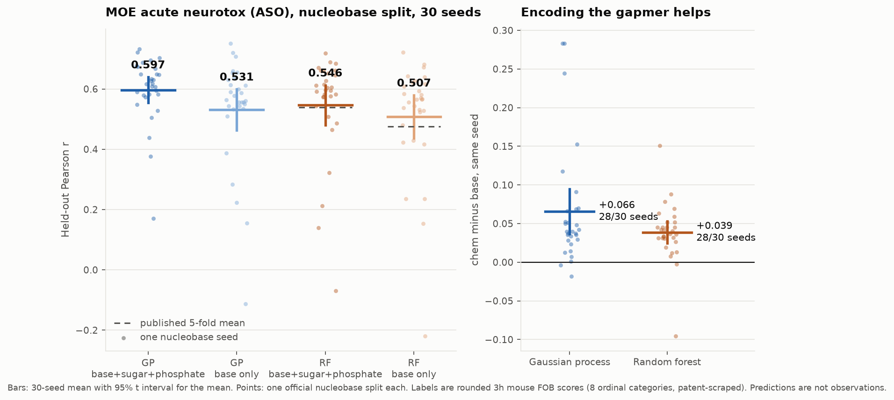

# Safety endpoint predictor: MOE acute neurotox (ASO)

**Protocol frozen 2026-11-14 before any evaluation seed was run. Results are appended
below the line "Results" only after the runs finish; nothing above that line changes
afterwards.** This mirrors `predictor-first-pass.md` (Huesken efficacy) for the
second endpoint, and it is a *predictor* study: no acquisition, no active-learning
claim, no design or reward use.

## Why this endpoint

`MOE_Neurotox_1` (benchmark alias `acute_neurotox_moe_cleaned`) replaced cytotox LNA
after Dr. Shuying Sun's note that the field runs phosphorothioate/2'-MOE chemistry,
not LNA. It is the only safety endpoint in the collection whose chemistry matches the
chemistry any later design work would be constrained to, and it is in vivo rather
than an in vitro caspase assay.

- 2,437 ASOs, 13 targets, single strand of 15-19 monomers.
- Label: 3h functional observational battery (FOB) score in mice, **rounded to eight
  ordinal categories** (0 safe .. 7 toxic), modelled as regression. `y` equals
  `round(y_raw)` on every row; the raw column correlates 0.996 with it.
- Provenance: scraped from thirteen patents. Expect selection effects — companies
  patent what works. Target mix is dominated by UBE3A-ATS (561), ATXN2 (357) and
  GFAP (340); SOD1 has 2 rows.
- Chemistry: every cytosine is 5-methylcytosine; 19 distinct gapmer patterns, the
  most common being 5 MOE / 10 DNA / 4 MOE; backbone is a mix of phosphorothioate
  (30,386 linkages) and phosphodiester (12,631).

## Design

- Split: official OligoGym **`nucleobase`** split per seed (8 k-mer clusters,
  `kmer_max=3`, `strand="RNA1"`, `test_size=0.2`), the same configuration as the
  published benchmark and as our Huesken work. No target split is run here, and none
  is claimed; 13 targets with that concentration would not support one well.
- Seeds **200-229** (30), fixed before any evaluation, disjoint from the Huesken
  seeds (100-129) and the acquisition seeds (100-149).
- Two featurizations, each crossed with two model families (four arms):
  - **`base`**: one-hot nucleobase only, declared alphabet (A, C, G, T, U, m5C),
    19 positions, 114 features.
  - **`chem`**: base + sugar + phosphate, 228 features — i.e. the encoding that
    spells out the gapmer wing/core pattern and the PS/PO backbone. The published
    leaderboard's best configurations for this dataset use exactly this encoding.
- Models: `OneHotGaussianProcess` and `OneHotRandomForest` behind the unchanged
  `Predictor` contract. The GP kernel is the one **frozen on Huesken** (RBF, initial
  length scale 4, `ConstantKernel * RBF + WhiteKernel`, bounds (1, 100)); it is not
  re-selected on this endpoint, so no selection on this data has taken place. The RF
  is the Gate 1 anchor configuration (100 trees, depth 20).
- Alphabets are module constants in `features/upstream.py`, not inferred from the
  rows being encoded, so the representation cannot depend on which rows are visible.
  Undeclared symbols raise instead of being encoded as all-zeros, which is what
  upstream's `OneHotEncoder` does silently.

## Published references (read from `benchmarks/oligogym_benchmarks.csv`)

Directly comparable, same model configuration, nucleobase split, five unseeded folds:

| Arm | Published mean Pearson r | Published fold SD |
| --- | ---: | ---: |
| RF, one-hot base | 0.4750 | 0.115 |
| RF, one-hot base+sugar+phosphate | 0.5394 | 0.1186 |

Context only, not a target: the dataset's best nucleobase configuration is a
Transformer on base+sugar+phosphate at **0.7025** (fold SD 0.0558), the best of 372
configurations, so it carries selection bias. There is no published GP on this
dataset, so the two GP arms have no reference and are reported as new numbers.

**The published folds on this dataset are extremely noisy.** Across RF one-hot
configurations the five-fold SD runs 0.04-0.32, and the same model family swings
from 0.32 to 0.58 across neighbouring hyperparameters. Any comparison to a single
published mean is therefore weak evidence in both directions. We report the gap in
units of combined standard error, as `gate1-resolution.md` does, rather than against
a fixed tolerance.

## Metrics (fixed in advance)

Pearson r (primary, for comparability with the published table) and Spearman rho
(reported alongside because the label is an eight-level ordinal and the dataset
metadata recommends both), plus RMSE, MAE and runtime. Mean over 30 seeds with
**sample SD**, never a confidence interval. For the GP arms: latent-SD spread, rank
correlation of uncertainty against absolute error and against distance to the
nearest training row, and interval coverage — the same uncertainty diagnostics as
the Huesken pass, since any later acquisition work on this endpoint depends on them.

## Expectations stated before running

- `chem` should beat `base`: the gapmer pattern is a known determinant of ASO
  toxicity, and the published ordering agrees (0.5394 vs 0.4750 for the RF anchor).
- The GP may do poorly. Its kernel was tuned on a different chemistry and a
  different label scale, and an eight-level ordinal is not what an RBF+White GP is
  built for. A null or below-RF result here is a reportable outcome, not a failure.
- Seed-to-seed SD should be large, in line with the published fold SD of about 0.11.

## Non-claims

No wet-lab, therapeutic or clinical safety claim. No target-generalization claim. No
combined safety/efficacy score: this endpoint stays separate from Huesken efficacy,
per `AGENTS.md`. A predicted FOB score is not an observation, and nothing here says
a designed molecule is safe.

> **Anchor configuration correction (2026-11-14).** Upstream's benchmark filtered `max_depth` out of its model arguments, so the published RF rows ran at unlimited depth whatever their label. Re-running these anchors both ways changes the result by at most 0.0012 and every anchor still reproduces. See [rf-anchor-recheck.md](rf-anchor-recheck.md).

## Results

Run 2026-11-14: 30 seeds (200-229) x 4 arms, no failures, about 7 minutes. 1,852
train / 585 test rows per seed. Dispersion is sample SD across seeds, not a
confidence interval.

**Two preregistration caveats, both recorded rather than cleaned up.** (1) The arms,
seeds and published references were fixed in `evaluate_neurotox_moe.py` before the
run started, but commit `e2f4de0` landed about two minutes *after* the run was
launched, so the freeze is evidenced by the script contents and this note, not by a
commit that precedes the run. (2) Seed 200 was run once beforehand as a smoke test
of the loader, the chemistry featurizer and a single GP fit, and its Pearson r was
seen (chem 0.626, base 0.587) before the 200-229 range was fixed. It is retained
rather than dropped. Excluding it moves nothing: GP chem 0.5959 +- 0.1141, GP chem
minus base +0.0666 (27/29 seeds), GP chem minus RF chem +0.0506, and both RF gaps
shift by under 0.001.

| Arm | Features | Mean Pearson r +- SD | Mean Spearman rho | Mean RMSE | Published mean | Gap | Gap in combined SE |
| --- | ---: | ---: | ---: | ---: | ---: | ---: | ---: |
| GP, base+sugar+phosphate | 228 | **0.5969 +- 0.1122** | 0.5805 | 1.676 | none (no published GP) | n/a | n/a |
| GP, base only | 114 | 0.5311 +- 0.1807 | 0.5300 | 1.760 | none | n/a | n/a |
| RF, base+sugar+phosphate | 228 | 0.5462 +- 0.1758 | 0.5368 | 1.777 | 0.5394 | +0.0067 | +0.11 |
| RF, base only | 114 | 0.5074 +- 0.1904 | 0.5011 | 1.819 | 0.4750 | +0.0324 | +0.52 |

Label SD is 2.174 FOB units, so the best arm's RMSE of 1.68 is a modest but real
reduction. GP fit and predict is about 4.9 s per seed on 1,852 rows.

### Reproduction of the published anchors

Both RF anchors land **above** their published means and well inside noise. Under
the revised Gate 1 criterion in `gate1-resolution.md`, the chem anchor passes both
parts (|gap| 0.0067 <= 0.03; z = +0.11). The base-only anchor passes part (b) at
z = +0.52 but misses part (a) at |gap| = 0.0324 — marginally, and in the *opposite*
direction to the Huesken anchors, which both came in low. With a published fold SD
of 0.115 on five unseeded draws, a 0.03 absolute tolerance is about half a standard
error here, so part (a) carries almost no information on this dataset. Nothing
suggests a systematic shift: one endpoint reruns slightly low, the other slightly
high.

The seed spread is the headline methodological point. The best arm ranges from
r = 0.170 to r = 0.733 across 30 nucleobase draws, and the worst arm goes negative
on some seeds. **A five-fold estimate on this dataset is close to uninformative**,
which is consistent with the published table, where neighbouring RF hyperparameters
swing from 0.32 to 0.58. Quote the 30-seed mean, never a single split.

### Chemistry encoding beats bases alone

The pre-stated expectation held, and it is the clearest effect in this study.
Paired by seed (same split, same rows):

| Model family | chem minus base | Positive seeds | dz |
| --- | ---: | ---: | ---: |
| Gaussian process | +0.0657 +- 0.0775 | 28/30 | 0.85 |
| Random forest | +0.0388 +- 0.0381 | 28/30 | 1.02 |

The specific paired tests were chosen after the means were seen, so treat the
p-values as exploratory (GP t p = 6.7e-05, Wilcoxon p = 4.7e-08; RF t p = 5.1e-06).
The *direction* was pre-declared and the published RF ordering agrees independently
(0.5394 chem vs 0.4750 base). Reading: for ASO neurotoxicity the gapmer wing/core
pattern and the PS/PO backbone carry signal the nucleobase sequence does not, which
is what one would expect and what the published best configurations encode.

GP beats RF on the chem encoding by +0.0507 paired (21/30 seeds, t p = 0.002,
exploratory). The GP also has markedly lower seed-to-seed SD (0.112 vs 0.176), i.e.
it is the more stable arm, not only the more accurate one.

### Context against the published leaderboard

The dataset's best published nucleobase configuration is a Transformer on
base+sugar+phosphate at 0.7025, the best of 372 configurations and so
selection-biased; the best published RF configuration is 0.6113 (depth 10, 100
trees, chem). Our GP at 0.5969 sits below both and above every published linear,
XGBoost and nearest-neighbour configuration. **We do not claim a new best on this
endpoint.** What the GP adds is calibrated-looking uncertainty and a 30-seed
estimate on a split where five folds are not enough to rank anything.

### Uncertainty diagnostics (mean over seeds)

| Arm | rho(SD, abs error) | rho(SD, distance to nearest train row) | SD CV | Coverage 1 SD | Coverage 1.96 SD | Noise SD |
| --- | ---: | ---: | ---: | ---: | ---: | ---: |
| GP chem | +0.109 | +0.689 | 0.134 | 0.638 | 0.935 | 0.82 |
| GP base | +0.049 | +0.719 | 0.069 | 0.636 | 0.938 | 1.12 |

Same diagnosis as Huesken, on a different endpoint and chemistry: **the GP latent SD
is mostly a novelty signal, not an error signal.** It tracks distance to the labelled
set (rho about 0.69-0.72) far better than it tracks absolute error (rho about 0.05-0.11).
That independently supports the reading in `acquisition-comparison.md` that what
helps acquisition there is coverage of sequence space rather than model uncertainty
as such. It was not tested by an acquisition run on this endpoint, and no such claim
is made here.

Interval coverage is close to nominal (0.638 against 0.68, 0.935 against 0.95), i.e.
slightly narrow but usable. The chem arm's uncertainty is also more informative
(CV 0.134 against 0.069), so it is the better candidate if acquisition is ever run
on this endpoint.

### What can and cannot be said

Can: on the official nucleobase split over 30 seeds, a one-hot GP that encodes
sugar and phosphate predicts rounded 3h mouse FOB score at Pearson r = 0.597 and
Spearman rho = 0.580; our two comparable published RF anchors reproduce within
noise; encoding gapmer chemistry beats nucleobases alone in 28 of 30 paired seeds.

Cannot: any claim that a designed molecule is safe, any target-generalization claim
(no target split was run), any best-on-leaderboard claim, any transfer of this
result to other chemistries or to the TLR immunomodulation endpoints, and any
combined safety/efficacy score. A predicted FOB score is a prediction, not an
observation. The labels are patent-scraped and rounded to eight ordinal categories,
so both selection effects and discretization remain in every number above.

### Chemistry compatibility, measured from the vendored files

Which molecules this model may legitimately score is a chemistry question, and the
collection answers it directly:

| Dataset | Modality | Strands | Sugar | Backbone | Cytosine | Length |
| --- | --- | ---: | --- | --- | --- | ---: |
| Huesken (efficacy) | siRNA duplex | 2 | `r` + `d` | `p` | C | 21+21 |
| MOE neurotox (this) | ASO gapmer | 1 | `moe` + `d` | `sp` + `p` | **m5C, every one** | 15-19 |
| TLR7 / TLR8 | ASO gapmer | 1 | **`m` (2'-OMe)** + `d` | `sp` | **plain C, no m5C** | 20 |
| OpenASO (efficacy) | ASO | 1 | `d` only | `sp` | C | 10-22 |
| ASOptimizer (efficacy) | ASO | 1 | **`cEt`**-dominant | `sp` | C | 16-20 |

Three consequences. The Huesken model cannot score an ASO at all: different
modality, 42 monomers against 19, no phosphorothioate anywhere in its training rows.
The TLR7/TLR8 sets contain no `moe` sugar and no `m5C` base, so scoring a 2'-MOE
m5C candidate with a TLR model is extrapolation in two channels at once; upstream's
`OneHotEncoder` would silently encode both as all-zeros, which is why the featurizer
here raises instead. And the mismatch lands on the mechanism: 5-methylcytosine is
the canonical suppressor of TLR-mediated immunostimulation, so the modification a
design step would reach for to reduce immune response is absent from the training
data of the only immune model available. ASOptimizer is cEt-dominant, the bridged
chemistry family Dr. Sun's note steered us away from.

This is the v4 lesson in a new form, and it constrains any later design work: a
reward may combine terms only within one chemistry, and the endpoint-specific
predictors are not interchangeable scorers for a shared candidate.
